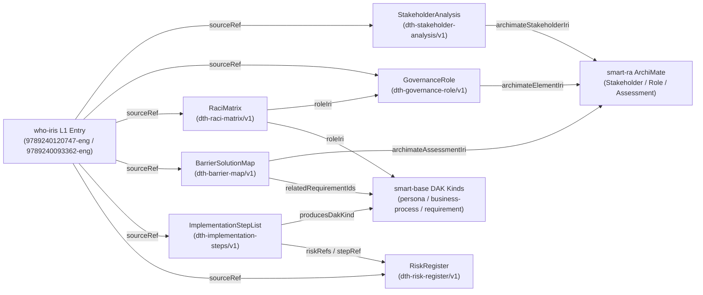

# DTH Governance and Planning Schemas Proposal (`smart-base` S3 Follow-Up)

- **Date:** 2026-10-31
- **Status:** Draft for architect-committee and handbook-owner review (`litlfred/smart-base#242`, `litlfred/dth-sfp#1` Step P6d, `litlfred/dth-phc#1` Step P4b)
- **Schema module:** [`smart-base/schemas/dth-planning-schemas.ts`](../../smart-base/schemas/dth-planning-schemas.ts) (re-exported at [`schemas/dth-planning-schemas.ts`](../../schemas/dth-planning-schemas.ts))
- **Verification suite:** [`smart-base/scripts/tests/dth-planning-schemas.test.ts`](../../smart-base/scripts/tests/dth-planning-schemas.test.ts)

---

## 1. Context and Boundary Rule

Per the owner's 2026-10-31 rulings on `litlfred/smart-base#242`, `litlfred/dth-phc#1` (§3d), and `litlfred/dth-sfp#1` (§2.4):

1. **Reuse DAK kinds wherever a DAK component fits.** Every L2 Digital Transformation Handbook (`dth-hrh`, `dth-phc`, `dth-sc`, `dth-pc`, `dth-sfp`) uses the existing `smart-base` DAK block kinds (`block-kinds/*.json`) for:
   - end-user personas (`persona`),
   - user scenarios (`user-scenario`),
   - BPMN 2.0 business processes (`business-process`),
   - core data elements (`data-element`),
   - DMN 1.5 decision tables (`decision-table`) and scheduling logic (`scheduling-logic`),
   - functional and non-functional requirements (`functional-requirement`, `non-functional-requirement`), and
   - M&E indicators (`indicator`).
2. **Do not overload DAK kinds with planning/governance structures that have different semantics.** Across the five DTH volumes, six recurring governance, stakeholder, barrier-mapping, and implementation-planning structures appear as structured tables or worksheet annexes that are not clinical/operational DAK components:
   - Organisational governance bodies and leadership roles (steering committees, technical working groups, advisory councils, project champions, regulators),
   - RACI responsibility assignment matrices (both populated tables and blank annex templates),
   - Risk and mitigation registers (both populated chapter risk tables and blank annex templates),
   - Barrier-to-candidate-solution mappings,
   - Multi-sectoral stakeholder analysis tables, and
   - Sequenced implementation / M&E planning step lists (including PHC's chapter-opener *"Who should be involved / Inputs / Outputs"* panels and PC's *"INPUTS / STEPS / RESOURCES / OUTPUTS"* tables).
3. **Review gate before block-kind promotion.** Per `smart-base#242`, new cross-DTH schemas require review by the architect committee and handbook owners before being wired into `block-kinds/` or enforced by corpus gates. Until promoted, these six schemas are provided as typed Zod 4 validators in `smart-base/schemas/dth-planning-schemas.ts` while narrative blocks in the handbooks retain their L1 citations.

---

## 2. Corpus Coverage Across the Five WHO DTH Handbooks

| Schema (`$schema`) | `dth-sfp` (`9789240120747-eng`) | `dth-phc` (`9789240093362-eng`) | `dth-pc` (`9789240116191-eng`) | `dth-sc` (`9789240089600-eng`) | `dth-hrh` (`9789240095687-eng`) |
|---|---|---|---|---|---|
| **`GovernanceRoleSchema`** (`dth-governance-role/v1`) | §2.3 governance bodies (steering committee, TWG, advisory council, NMRA regulator) | Ch 1 §1.1.2 PCPOSS governance & coordination bodies | Ch 1–2 national product catalogue governance committee & steward | Ch 1 supply-chain digital transformation steering committee | Ch 1–2 HRIS steering committee & TWG |
| **`RaciMatrixSchema`** (`dth-raci-matrix/v1`) | Annex 4 RACI matrix template & §2.3 | Annex 2 RACI matrix worksheet | Ch 2 governance responsibility assignments | Ch 1–2 supply-chain governance roles | Ch 3 RACI tables |
| **`RiskRegisterSchema`** (`dth-risk-register/v1`) | Annex 7 risk & mitigation register template | Ch 1–5 planning risk callouts & Annex worksheets | Ch 1–5 step risk & mitigation tables | Ch 1–3 implementation risk tables | Ch 3–5 rollout risk tables |
| **`BarrierSolutionMapSchema`** (`dth-barrier-map/v1`) | Table 5 (reporting barriers → candidate solutions) & Annex 6 | Ch 1 Table 1 (PHC point-of-service challenges & digital responses) | Ch 1 product master data fragmentation barriers | Ch 1 traceability & visibility barriers | Ch 1 workforce data fragmentation barriers |
| **`StakeholderAnalysisSchema`** (`dth-stakeholder-analysis/v1`) | Ch 1 Table 2 (NMRA, customs, law enforcement, manufacturers, civil society, WHO GSMS) | Ch 1 Table 2 (MoH, subnational health offices, facilities, health workers, patients) | Ch 1 Table 1 product catalogue stakeholder groups | Ch 1 supply-chain stakeholder groups | Ch 1 HRH stakeholder mapping |
| **`ImplementationStepListSchema`** (`dth-implementation-steps/v1`) | Tables 14, 15, 17 (implementation & M&E planning steps) | Ch 1–6 *"Who should be involved / Inputs / Outputs"* panels & Ch 3 DAK method steps | Ch 1–5 `INPUTS / STEPS / RESOURCES / OUTPUTS` tables | Ch 1–3 sequenced implementation steps | Ch 2–5 planning step tables |

---

## 3. Proposed Schema Specifications

### 3.1 `GovernanceRoleSchema` (`dth-governance-role/v1`)

Models an organisational governance body or leadership role that directs, coordinates, or regulates the digital transformation programme (as distinct from an individual clinical/operational end-user `persona`).

| Field | Type | Required | Description |
|---|---|---|---|
| `$schema` | `"dth-governance-role/v1"` | Defaulted | Schema discriminator tag |
| `id` | `string` | Yes | Stable identifier (e.g. `"SFP-GOV-01"`) |
| `name` | `string` | Yes | Human-readable name (e.g. `"National SF Medical Products Steering Committee"`) |
| `roleType` | `"steering-committee" \| "technical-working-group" \| "advisory-council" \| "project-champion" \| "coordinator" \| "regulator"` | Yes | Governance classification |
| `mandate` | `string` | Yes | Mandate, terms of reference, or statutory authority |
| `chairOrLeadRoleIri` | `RoleOrElementIri` | Yes | IRI of the chairing or leading role/actor |
| `memberRoleIris` | `RoleOrElementIri[]` | Yes (`>= 1`) | IRIs of constituent member roles or stakeholder bodies |
| `meetingCadence` | `string` | Yes | Stated meeting or review cadence |
| `decisionRights` | `string[]` | Yes (`>= 1`) | Explicit approval authorities and decision rights |
| `archimateElementIri` | `RoleOrElementIri` | Yes | Link to `smart-ra` ArchiMate Business Role, Actor, or Collaboration IRI |
| `sourceRef` | `DthSourceRef` | Yes | L1 handbook citation (`libraryId`, `sectionId`, `pages`, `tableOrAnnex`, `quote`) |

### 3.2 `RaciMatrixSchema` (`dth-raci-matrix/v1`)

Models a Responsibility Assignment Matrix (`R` = Responsible, `A` = Accountable, `C` = Consulted, `I` = Informed) across activities and DIIG phases.

| Field | Type | Required | Description |
|---|---|---|---|
| `$schema` | `"dth-raci-matrix/v1"` | Defaulted | Schema discriminator tag |
| `id` | `string` | Yes | Stable identifier (e.g. `"SFP-RACI-ANNEX-04"`) |
| `title` | `string` | Yes | Matrix title |
| `mode` | `"template" \| "populated"` | Default `"populated"` | Distinguishes populated matrices from blank annex worksheet templates |
| `roles` | `(RoleOrElementIri \| { roleId, label?, roleIri })[]` | Yes (`>= 1`) | Participating persona or governance-role IRIs |
| `activities` | `RaciActivity[]` | Yes (`>= 1`) | Rows with `activityId`, `activity`, `phase`, and `assignments: Record<roleId, ("R" \| "A" \| "C" \| "I")[]>` |
| `sourceRef` | `DthSourceRef` | Yes | L1 handbook citation |

**Validation invariants (`superRefine`):**
1. Every `roleId` key in `activity.assignments` must be declared in `roles[]` (matching either a string IRI or a `RaciRoleColumn.roleId` / `roleIri`).
2. When `mode === "populated"`, every activity must have **at least one `"A"` (Accountable)** assignment.
3. When `mode === "template"` (e.g., SFP Annex 4 or PHC Annex 2 blank worksheets), activities may omit `"A"` assignments so the template structure can be captured without fabricating country-specific assignments.

### 3.3 `RiskRegisterSchema` (`dth-risk-register/v1`)

Models a risk and mitigation register in either `"populated"` mode (PC Ch 1–5 risk tables, PHC Ch 1–5 risk callouts) or `"template"` mode (SFP Annex 7 risk log template).

| Field | Type | Required | Description |
|---|---|---|---|
| `$schema` | `"dth-risk-register/v1"` | Defaulted | Schema discriminator tag |
| `id` | `string` | Yes | Stable identifier (e.g. `"PC-RISK-REG-CH02"`) |
| `title` | `string` | Yes | Register title |
| `mode` | `"template" \| "populated"` | Yes | Populated risk table vs blank worksheet template |
| `entries` | `RiskEntry[]` | Yes (`>= 1` when populated) | Rows with `riskId`, `category`, `riskDescription`, `likelihood?`, `impact?`, `priority?`, `mitigation`, `ownerRoleIri?`, `stepRef?`, `sourceRef?` |
| `sourceRef` | `DthSourceRef` | Yes | L1 handbook citation |

**Validation invariants (`superRefine`):**
- When `mode === "populated"`, `entries` must contain at least one risk row.
- When `mode === "template"`, `entries` may be empty (`[]`) or contain illustrative template rows.

### 3.4 `BarrierSolutionMapSchema` (`dth-barrier-map/v1`)

Models the mapping from health-system or reporting barriers to affected roles, candidate digital/policy solutions, functional/non-functional requirements, and `smart-ra` ArchiMate Motivation `Assessment` elements.

| Field | Type | Required | Description |
|---|---|---|---|
| `$schema` | `"dth-barrier-map/v1"` | Defaulted | Schema discriminator tag |
| `id` | `string` | Yes | Stable identifier (e.g. `"SFP-BAR-TBL-05"`) |
| `title` | `string` | Yes | Barrier map title |
| `entries` | `BarrierSolutionEntry[]` | Yes (`>= 1`) | Rows with `barrierId`, `category`, `barrier`, `affectedRoleIris[]`, `candidateSolutions[]`, `relatedRequirementIds[]`, `archimateAssessmentIri?`, `sourceRef?` |
| `sourceRef` | `DthSourceRef` | Yes | L1 handbook citation |

### 3.5 `StakeholderAnalysisSchema` (`dth-stakeholder-analysis/v1`)

Models DIIG Phase 1 multi-sectoral stakeholder mapping tables (SFP Table 2, PHC Ch 1 Table 2).

| Field | Type | Required | Description |
|---|---|---|---|
| `$schema` | `"dth-stakeholder-analysis/v1"` | Defaulted | Schema discriminator tag |
| `id` | `string` | Yes | Stable identifier (e.g. `"SFP-STK-TBL-02"`) |
| `title` | `string` | Yes | Stakeholder table title |
| `stakeholders` | `StakeholderEntry[]` | Yes (`>= 1`) | Rows with `stakeholderId`, `name`, `sector`, `roleInSystem`, `interestOrInfluence`, `engagementMechanism`, `roleIri?`, `archimateStakeholderIri?`, `sourceRef?` |
| `sourceRef` | `DthSourceRef` | Yes | L1 handbook citation |

### 3.6 `ImplementationStepListSchema` (`dth-implementation-steps/v1`)

Models sequenced implementation and M&E planning steps (SFP Tables 14, 15, 17; PHC Ch 1–6 phase panels and Ch 3 DAK-method steps; PC Ch 1–5 step tables; SC Ch 1–3 steps; HRH planning steps) per `smart-base#242` item 2.

| Field | Type | Required | Description |
|---|---|---|---|
| `$schema` | `"dth-implementation-steps/v1"` | Defaulted | Schema discriminator tag |
| `id` | `string` | Yes | Stable identifier (e.g. `"SFP-STEPS-TBL-14"`) |
| `title` | `string` | Yes | Step list or phase panel title |
| `diigPhase` | `string` | Optional | DIIG phase alignment (e.g. `"Phase 5: Determine requirements"`) |
| `steps` | `ImplementationStep[]` | Yes (`>= 1`) | Ordered steps with `stepNumber`, `stepId?`, `title`, `description`, `leadRoleIri?`, `participatingRoleIris[]`, `inputs[]`, `toolsOrResources[]`, `outputs[]`, `producesDakKind?`, `riskRefs?`, `sourceRef?` |
| `sourceRef` | `DthSourceRef` | Yes | L1 handbook citation |

**Validation invariants (`superRefine`):**
1. `steps[]` must have strictly increasing, duplicate-free positive integer `stepNumber` values.
2. `leadRoleIri` and every entry in `participatingRoleIris[]` must be valid role IRIs (never free text), enabling mechanical BPMN swimlane generation where a step table describes an operational process (`smart-base#242` item 2).
3. `producesDakKind`, when present, is constrained to the 21 canonical DAK block kinds in `smart-base/block-kinds/*.json`.

---

## 4. Traceability to `smart-ra`, BPMN Swimlanes, and L1 Coverage

---

## 5. Decisions Requested from the Architect Committee and Handbook Owners

1. **Block-kind promotion vs structured companion JSON:** Should all six schemas become first-class `folio-block-kind/v1` nodes under `smart-base/block-kinds/` (with JSON-LD mappings under `smart-base:`), or should `GovernanceRole` become an extension of `actor-definition` / `persona` while the five tabular artefacts (`RaciMatrix`, `RiskRegister`, `BarrierSolutionMap`, `StakeholderAnalysis`, `ImplementationStepList`) are registered as DTH planning block kinds?
2. **Inline vs referenced risks on `ImplementationStepList`:** In `dth-pc`, risk and mitigation columns sit adjacent to `INPUTS / STEPS / RESOURCES / OUTPUTS`, whereas in `dth-sfp` (Annex 7) and `dth-phc` they sit in separate registers or callout boxes. This proposal links them via `ImplementationStep.riskRefs[]` ↔ `RiskEntry.stepRef` so both layouts share one normalised schema without duplicating risk fields inside step rows. Does the committee approve this normalisation?
3. **Template mode (`mode: "template"`) for Annex worksheets:** Both `dth-sfp` (Annexes 4 and 7) and `dth-phc` (Annex 2) ship blank worksheet templates alongside populated guidance tables. Does the committee approve `mode: "template" | "populated"` on `RaciMatrixSchema` and `RiskRegisterSchema` so blank L1 annexes are captured formally without inventing synthetic country data?
